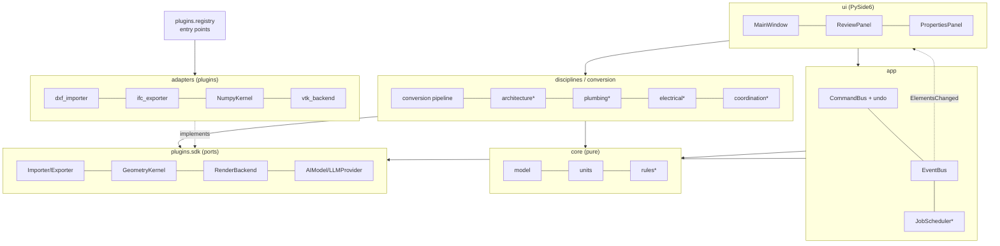
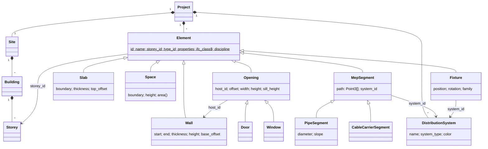

# BIMForge: Design Document

Status: MVP scaffold implemented (DXF → walls/doors/windows/rooms/slab → review → 3D viewer → IFC4).
Language: Python 3.11–3.13. Distribution assumption: commercial closed-source, so GPL/AGPL dependencies are excluded from the shipped app.

---

## 1. Technology stack

| Concern | Choice | License | Notes |
|---|---|---|---|
| Language | Python 3.12, plus pybind11 C++ extensions for measured hot spots | PSF | |
| UI | PySide6 (Qt 6) | LGPL-3 | |
| Viewport | VTK 9, behind `RenderBackend` | BSD | Replaceable (Filament, or WebGL in QWebEngine) |
| B-rep kernel | OpenCASCADE via pythonocc-core, as a `GeometryKernel` plugin | LGPL-2.1+exc | pythonocc-core is **conda-only**. The MVP ships a NumPy prism kernel. |
| 2D geometry | Shapely 2 (GEOS), numpy | BSD/LGPL | |
| Spatial index / clash | rtree, python-fcl, Manifold | MIT/BSD/Apache | |
| IFC | IfcOpenShell 0.8+ (0.9 tested) | LGPL-3 | |
| DXF | ezdxf | MIT | |
| DWG / DGN | ODA File Converter (user-installed) → ODA Drawings SDK | Proprietary | Optional plugin |
| RVT | IFC round-trip → Revit add-in bridge (C#) → APS (opt-in cloud) | — | Optional plugins |
| PDF | pdfplumber (vector), pypdfium2 (raster) | MIT / Apache | Avoid PyMuPDF (AGPL) |
| Raster | OpenCV | Apache-2 | |
| AI | PyTorch (training), ONNX Runtime + DirectML/CUDA (inference) | BSD / MIT | Avoid Ultralytics (AGPL) |
| OCR | PaddleOCR / docTR | Apache-2 | |
| LLM | `LLMProvider`: llama.cpp (local) or a cloud API (opt-in) | — | |
| Project store | SQLite single file, event log | Public domain | |
| Packaging | PyInstaller one-folder (keeps LGPL libraries replaceable) | — | |

**LGPL compliance:** link dynamically, ship the license texts, don't modify LGPL libraries without publishing the changes, and never build a single-file executable that welds LGPL code into the binary.

---

## 2. Architecture


`*` = planned. **Dependency rule:** arrows only point inward. `core` imports nothing from the rest of the app, and `ui` is the only package that imports Qt or VTK.

| Boundary | Contract |
|---|---|
| UI → app | `CommandBus.execute(Command)`, `undo()`, `redo()` |
| app → UI | `EventBus` publishes `ElementsChanged(added, modified, removed)` |
| conversion → UI | `ConversionResult.proposals: list[Proposal]` (element, confidence, accepted, sources) |
| geometry → render | `Mesh(vertices, faces)` + `RenderStyle`. The renderer never sees domain objects. |
| adapters → app | `ImportResult(drawing: Drawing2D | None, project: Project | None)` |
| AI → app | `Detection`s → proposals. LLM `ToolCall`s → `Command`s that go through review first. |

---

## 3. Core data model



- **Units:** metres internally. Conversion happens only at import and export.
- **Identity:** element ids are UUIDs. The IFC `GlobalId` is derived from the element id (uuid5), so exporting twice gives the same GUIDs.
- **Placement:** plan coordinates are relative to the project origin. Heights are relative to the storey elevation, so changing a storey's elevation moves everything on it.
- **Types (planned):** an `ElementType` (e.g. door type) holds shared parameters. An element's `type_id` links to it, and instance `properties` override type values.
- **Persistence** ✓ ([`app/persistence.py`](../src/bimforge/app/persistence.py)): `.bimx` is a single SQLite file with `meta`, `systems` and `elements(id, class, storey_id, json)` tables.
  - **Atomic save:** the file is written to a temporary copy, then swapped in with `os.replace`.
  - **Schema evolution:** a missing field loads with its default, an unknown field is ignored, an unknown element class is skipped with a warning, and a file from a newer schema version is refused.
  - **Plugin elements:** plugins register their element classes with `register_element_type`.
  - **Autosave** writes a `.autosave` copy every 2 minutes when there are unsaved changes, and offers recovery on open.
  - **Planned:** an append-only `events` table for incremental saves and version history.
- **Editing** ✓ ([`app/commands.py`](../src/bimforge/app/commands.py)): `ModifyElement` (checked by [`core/validation.py`](../src/bimforge/core/validation.py) and rolled back if invalid), `MoveElements`, `RemoveElements` and `CompositeCommand`, which applies all of its sub-commands or none. `CommandBus.is_dirty` tracks unsaved changes.

**IFC mapping**

| Domain | IFC |
|---|---|
| Wall | `IfcWall` + `SweptSolid` body. Openings use `IfcRelVoidsElement` → `IfcOpeningElement`. |
| Door / Window | `IfcDoor` / `IfcWindow` filling the opening via `IfcRelFillsElement` |
| Slab | `IfcSlab` (extruded polyline) |
| Space | `IfcSpace`, aggregated under the storey |
| DistributionSystem | `IfcDistributionSystem` + `IfcRelAssignsToGroup` |
| PipeSegment / CableCarrierSegment | `IfcPipeSegment` / `IfcCableCarrierSegment`, ports via `IfcDistributionPort` |

---

## 4. Plugin interfaces

The full definitions are in [`src/bimforge/plugins/sdk.py`](../src/bimforge/plugins/sdk.py). Summary:

```python
class Importer(Plugin):         extensions; import_file(path, options) -> ImportResult
class Exporter(Plugin):         extensions; export(project, path, options) -> list[warnings]
class GeometryKernel(Plugin):   capabilities; extrude(profile, z0, h) -> Mesh; boolean_difference; sweep
class RenderBackend(Plugin):    upsert_mesh/lines, remove, clear, set_category_visible,
                                set_highlight, pick(x, y) -> key, fit_view, set_view, render
class AIModel(Plugin):          task; labels; runtime; predict(InferenceInput) -> list[Detection]
class LLMProvider(Plugin):      is_local; complete(messages, tools) -> LLMResponse(text, tool_calls)
```

**Writing a third-party plugin.** The example is a separate pip package:

```toml
# pyproject.toml of "bimforge-oda"
[project.entry-points."bimforge.importers"]
dwg = "bimforge_oda:DwgImporter"
```

```python
class DwgImporter(Importer):
    info = PluginInfo(id="com.example.dwg", name="DWG via ODA", version="1.0", license="Proprietary")
    extensions = (".dwg",)

    @classmethod
    def available(cls) -> bool:          # hidden if the ODA converter is not installed
        return shutil.which("ODAFileConverter") is not None

    def import_file(self, path, options=None):
        dxf = convert_with_oda(path)      # DWG -> temporary DXF, out of process
        return DxfImporter().import_file(dxf)
```

**Plugin rules:**
- Load failures are isolated and reported (`PluginRegistry.errors`).
- The registry refuses plugins built against a newer `api_version`.
- Phase 4 adds signed plugin manifests and a permission model: file system access, network access, and access to cloud AI.

---

## 5. 2D → 3D conversion pipeline

✓ = implemented in the MVP ([`src/bimforge/conversion`](../src/bimforge/conversion)).

| # | Step | Method |
|---|---|---|
| 0 | **Ingest** ✓ | The format adapter produces a `Drawing2D`: layers, segments/polylines, arcs, text, block references (with extents and attributes), dimensions |
| 1 | **Raster/PDF vectorisation** | Raster: deskew, binarise, then a line segment detector (LSD) or a learned wall-segmentation mask turned into a skeleton and then polylines. Vector PDF: drawing paths become segments. |
| 2 | **Units and scale** ✓ (partial) | Order of preference: header units (✓), user override (✓), extent heuristic (✓). Planned: calibrate from OCR'd dimension strings against measured lengths, and from scale bars. |
| 3 | **Layer semantics** ✓ | Regex rules (✓) → `AIModel(task="layer_classification")`. Annotation, furniture and grid layers are excluded from wall search. |
| 4 | **Wall faces → centrelines** ✓ | Pair parallel segments at thickness distance (0.05–0.6 m, angle ≤ 2°, face drift ≤ 2 cm, overlap ≥ 0.3 m). Thinnest partner wins. Partial overlaps are tracked so a long face can pair with several split faces. Confidence = layer score × (parallelism + coverage). |
| 5 | **Topology repair** ✓ | Merge collinear pieces across junction gaps (≤ 0.5 m). Extend endpoints to L and T intersections (reach 0.75 × thickness). |
| 6 | **Openings** ✓ | Door/window symbols come from block name or layer. A symbol sitting in a gap between collinear walls merges the two walls; the opening takes its width from the gap (confidence 0.9). Otherwise the symbol is hosted in the wall it overlaps, with width from the block extent (confidence 0.675). Overlapping openings are rejected. |
| 7 | **Rooms and slab** ✓ | Snap-rounded noding of the centrelines, then polygonize, then filter by area. The slab is the union of the rooms, mitre-buffered by half the wall thickness. Planned: room names from OCR text inside each polygon. |
| 8 | **Other elements** | Columns (small closed hatched polygons), stairs (parallel tread lines plus an arrow), and grids (long lines on grid layers with bubble text) |
| 9 | **Multi-storey** | One plan per storey. Align using grid intersections (RANSAC on matched grid labels) or a user-picked pair of points. Storey elevations and heights come from section/elevation level marks (OCR "+3.000", "FFL"). |
| 10 | **Review** ✓ | Proposals with confidence (green ≥ 80 %, amber ≥ 50 %, red below) and accept/reject per element. Rejecting a wall drops its openings. Orange previews show in the 3D view. |
| 11 | **Commit** ✓ | One `AddElements` command, so the whole conversion undoes as a single step |

---

## 6. AI pipeline

**Models**

| Task | Input | Model (permissive license) | Notes |
|---|---|---|---|
| Symbol detection (doors, windows, sanitary fixtures, electrical symbols) | Raster tiles at a fixed resolution (e.g. 1024 px for 5 m) | RT-DETR or YOLOX, exported to ONNX | For vector drawings, block references are used first and the detector covers exploded or unblocked symbols |
| Wall segmentation | Raster | U-Net or DeepLabv3+ (ResNet backbone) → skeleton | Scans and PDFs |
| Vector primitive classification | Graph of segments (nodes = primitives, edges = adjacency or parallelism) | GNN (GAT/GraphSAGE) in PyTorch Geometric (MIT) | Labels every line in a DXF as wall, door, window, furniture, etc. Most accurate for CAD input. |
| OCR | Text crops | PaddleOCR det+rec (ONNX) | Dimension parser handles `3'-6"`, `3600`, `3.60` |
| Layer classification | Layer name tokens + geometry statistics | Gradient boosting (LightGBM, MIT) | Small, fast, explainable |
| MEP mapping | Detected symbol + legend OCR | Embedding similarity against the family library | Legend-aware: reads the drawing's own symbol legend |
| Natural-language assistant | Chat + command JSON schemas | `LLMProvider` with tool calling | Output is proposed `Command`s, never applied directly |

**Training data**

| Source | License | Use |
|---|---|---|
| FloorPlanCAD (≈15k CAD plans, line-level labels) | **CC BY-NC 4.0** | Research and benchmarking only. ⚠️ Not for weights in a commercial product without permission. |
| CubiCasa5K | **CC BY-NC 4.0** | Same restriction |
| RPLAN, R2V | Research-only | Benchmarking |
| **Self-labelled company/customer DXFs** | Contract | Main commercial source |
| **Synthetic plans** | Own | Procedural plan generator (rooms → walls → openings → furniture). Rendered with varied layer conventions, line weights, noise, scan artefacts and hand annotations. MEP symbols placed from IS/BS/ANSI symbol libraries. |

**Labeling strategy**
1. **Weak labels for free:** well-layered DXFs already label every primitive by layer and block name. Rasterising them gives pixel-accurate masks and boxes.
2. **Human correction** in CVAT (MIT) or Label Studio (Apache) for scans and badly layered files.
3. **Active learning:** accept/reject/edit actions in the review panel become labelled examples. They are stored locally and uploaded only with explicit opt-in. Low-confidence or uncertain samples are queued for annotation first.
4. **Drawing-style stratification:** splits are made by source office or firm, not by sheet, so test scores measure generalisation to new drawing styles.

**Metrics and release gates**

| Level | Metric | MVP gate |
|---|---|---|
| Symbols | mAP@0.5, per-class recall | Door/window recall ≥ 0.95 on clean CAD |
| Walls | Centreline segment precision/recall (match within 5 cm and 3°), thickness MAE | P/R ≥ 0.95, MAE ≤ 1 cm on clean CAD |
| Openings | Placement error along the wall, width error | ≤ 5 cm |
| OCR | Character error rate, dimension parse accuracy | ≥ 0.98 on dimensions |
| Calibration | Expected calibration error of confidences | ≤ 0.05, so the green/amber/red bands mean what they say |
| **End to end** | **Correction effort:** share of proposals edited or rejected, review time per 100 m² | Tracked per release. A model ships only if it doesn't regress on the frozen benchmark. |

---

## 7. Folder structure

```
revit/
├── index.py                      # run from source: python index.py view|convert|sample
├── pyproject.toml                # deps, extras [ifc, ui, dev], plugin entry points
├── docs/DESIGN.md
├── samples/                      # generated demo DXF/IFC
├── src/bimforge/
│   ├── __main__.py               # CLI
│   ├── core/                     # model.py, units.py, (rules/, types.py)*
│   ├── drawing/                  # Drawing2D primitives
│   ├── geometry/                 # mesh, polygon, vec2, kernel (NumPy), builders (tessellation)
│   ├── conversion/               # settings, layers, walls, openings, rooms, pipeline
│   ├── app/                      # commands, events, (jobs, session, persistence)*
│   ├── plugins/                  # sdk.py (interfaces), registry.py
│   ├── adapters/                 # dxf_importer, ifc_exporter, (ifc_importer, pdf, raster, dwg_oda, rvt_bridge)*
│   ├── render/                   # vtk_backend
│   ├── ui/                       # main_window, panels
│   ├── devtools/                 # sample_plan generator
│   ├── ai/*                      # registry, preprocess, postprocess, onnx_runtime, llm/
│   └── disciplines/*             # architecture/, plumbing/, electrical/, coordination/
├── tests/                        # pytest + hypothesis
├── plugins/*                     # first-party optional plugins (separate packages): occt, oda, rvt
├── training/*                    # datasets/, synth/, models/, eval/ (not shipped)
└── revit-addin/*                 # C# Revit add-in bridge (Phase 3)
```
`*` = planned

---

## 8. Roadmap

Assumes a team of 3–5 engineers. Durations are rough estimates.

| Phase | Scope | Exit criteria |
|---|---|---|
| **1 MVP** ✅ | DXF import, wall/door/window/room/slab detection, review UI, viewer, IFC4 import and export, `.bimx` save/load with autosave, editing with validation, connected walls, multi-level (levels panel, active level, duplicate level), Windows build (`packaging/build_windows.ps1`) | Done. Remaining polish: interactive drag in the viewport, signed installer (MSI/MSIX). |
| **2 MEP + coordination** ✅ (core) | Fixture catalog. Plumbing systems with pipe drawing, automatic drainage grading and network sizing (IPC tables). Electrical circuits with loads, breaker and cable selection, voltage drop, panel schedule and SVG single-line diagram. Conduit and cable tray. Clash detection (AABB broad phase → FCL plus containment; hard and clearance), issue tracking that keeps status across re-runs, model checks, BOQ to XLSX/CSV, section box, measure. MEP and systems exported to IFC. | Remaining: fittings (elbows/tees as elements), duct/HVAC, mapping imported IFC MEP back to parametric pipes, performance work for 50k+ elements |
| **3 AI + proprietary formats** (6–9 mo) | MEP symbol detection, GNN primitive classifier, raster/PDF pipeline, OCR dimension calibration, A*/visibility-graph auto-routing with clearance and slope rules, DWG/DGN via ODA, Revit add-in bridge, glTF/OBJ/FBX/DWG export | Symbol recall ≥ 0.9 on noisy scans. Round trip through Revit. |
| **4 Assistant + 4D + marketplace** (6+ mo) | Natural-language assistant (tool calling, local or cloud), 4D phase/timeline linking, plugin signing and marketplace, regional code packs (IS, BS, IPC/NEC), macOS/Linux builds | — |

---

## 10. Risks and mitigations

| Risk | Impact | Mitigation |
|---|---|---|
| DWG/RVT are closed formats | Can't read the most common inputs | IFC round-trip first. ODA as an optional paid plugin. Revit add-in bridge. Budget the ODA membership early. |
| Noisy, inconsistent drawings (layer chaos, exploded blocks, scans) | Low accuracy, lost trust | Geometry rules plus AI ensemble, confidence-ranked review, correction-effort metric, active learning, style-stratified evaluation. Always reversible. |
| Training data licenses (FloorPlanCAD and CubiCasa are non-commercial) | Legal exposure | Train production weights on synthetic and contracted data only. Keep a dataset-provenance register. |
| Model licenses (Ultralytics AGPL, SegFormer non-commercial) | Forced open-sourcing | Allow-list of permissive architectures. License check in CI (`pip-licenses`). |
| Python performance at 100k+ elements | Laggy viewport, slow conversion | Batched/instanced VTK actors, cached tessellation, BVH culling, numpy vectorisation, process pool. Move proven hot spots to C++/Rust. The render backend can be swapped. |
| pythonocc-core is conda-only | Packaging friction | NumPy kernel by default. OCCT as an optional plugin with its own build, or call OCCT through IfcOpenShell's bundled geometry. |
| LGPL obligations (Qt, OCCT, IfcOpenShell) | Compliance | One-folder builds, dynamic linking, license notices, written source offer |
| Cloud AI data leakage | Client confidentiality | Offline by default. Per-project opt-in. `LLMProvider.is_local`. Redaction of title blocks and metadata before upload. |
| IFC export fidelity varies by consuming tool | Bad imports downstream | Validate with IfcOpenShell's validator and buildingSMART validation. Round-trip tests against Revit, ArchiCAD and Solibri in CI. |
| Scope creep (it's "Revit plus AI") | Delays | Phase gates with measurable exit criteria. Plugin SDK so niche formats come from partners. |
