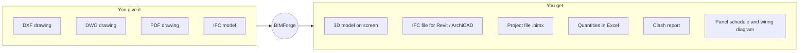
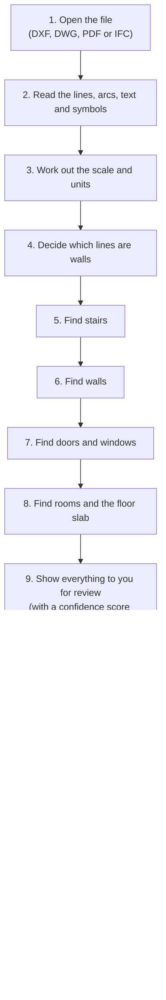
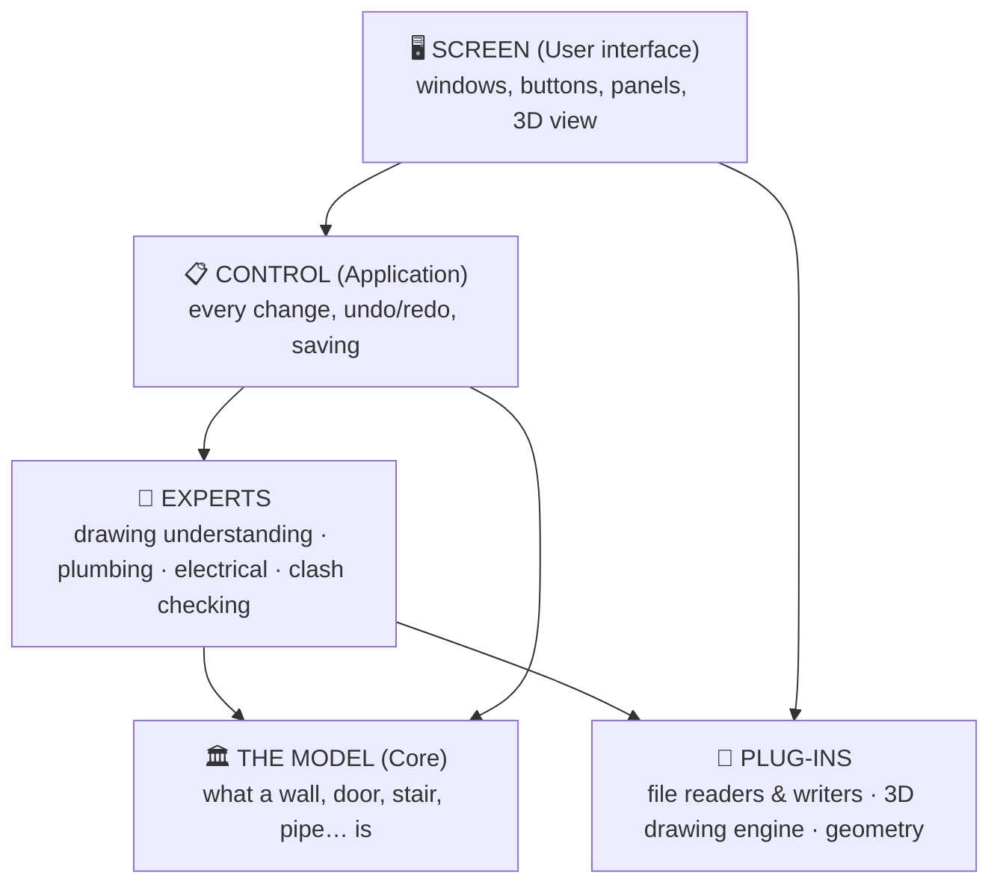
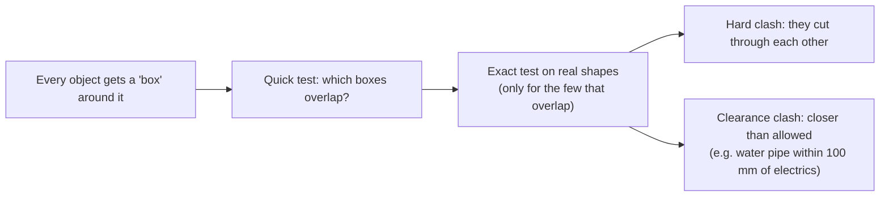

# How BIMForge Works

*A step-by-step guide for anyone. No programming or BIM knowledge needed.*

---

## 1. What is BIMForge?

Architects and engineers draw buildings as **2D drawings**: flat plans made of lines, arcs and text, the way a building looks from above. A computer sees such a drawing only as lines. It doesn't know that two parallel lines are a *wall*, or that a curved line is a *door swing*.

**BIMForge reads a 2D drawing, works out what each group of lines means, and builds a 3D model of the building from it.** In that 3D model every object knows what it is:

| In the 2D drawing | In the BIMForge 3D model |
|---|---|
| Two parallel lines 300 mm apart | A **wall**: 300 mm thick, 3 m tall, with a start and an end point |
| A quarter-circle next to a gap | A **door**, 900 mm wide, hosted in a wall |
| Several evenly spaced short lines | A **staircase** with 12 steps |
| An area enclosed by walls | A **room** with a floor area |

A model that understands its objects like this is called a **BIM model** (Building Information Model). Once you have it, you can also add plumbing and electrical services, check for collisions, count quantities, and send the model to other programs such as Revit or ArchiCAD.

### What goes in, and what comes out



---

## 2. The journey of a drawing: the big picture

This is everything that happens, from opening a file to getting the result. Each step is explained in detail later.



One rule runs through the whole design: **the computer proposes, the person decides.** Nothing detected from a drawing goes into the model until you have seen it and clicked **Commit**. Every change can also be undone.

---

## 3. How the program is organised

Think of the software like a building with floors. Each floor has one job and only talks to the floors next to it. This keeps it easy to change one part, for example adding a new file format, without breaking the others.



| Floor | What it does | Where it is in the code |
|---|---|---|
| **The model** | Describes the building: project, levels, walls, doors, windows, stairs, columns, rooms, slabs, pipes, cable trays, fixtures, systems, issues. It's like a dictionary of building parts. | `src/bimforge/core/` |
| **Experts** | Clever logic: reading drawings (`conversion/`), plumbing rules (`disciplines/plumbing.py`), electrical rules (`disciplines/electrical.py`), clash checks and quantities (`coordination/`) | `src/bimforge/conversion/`, `disciplines/`, `coordination/` |
| **Control** | Every change to the model goes through here as a "command", which is what makes undo/redo, saving and autosave work | `src/bimforge/app/` |
| **Plug-ins** | Readers for DXF, DWG, PDF and IFC; the IFC writer; the 3D drawing engine (VTK); the shape builder | `src/bimforge/adapters/`, `render/`, `geometry/` |
| **Screen** | The window you work in | `src/bimforge/ui/` |

The model knows nothing about screens or file formats. That's deliberate: the same model can be shown in a different viewer, or saved in a different format, without changing it.

---

## 4. Step by step: turning a drawing into a 3D model

### Step 1 – Opening the file

Each file type has its own **reader** (a plug-in). Every reader produces the same thing: a neutral list of **lines, polylines, arcs, text, filled shapes and symbols (blocks)**. From this point on, the rest of the program doesn't care where the drawing came from.

| File | How it's read |
|---|---|
| **DXF** | Read directly. Layers, units and symbols (blocks) are kept. A floor plan that was drawn *inside* a block is unpacked ("exploded"). |
| **DWG** | DWG is a closed Autodesk format. BIMForge asks the free **ODA File Converter** (installed separately) to turn it into DXF, then reads the DXF. |
| **PDF** | Only "vector" PDFs exported from CAD work (lines stay sharp when you zoom in). Scanned PDFs are images with no lines to read, and BIMForge tells you so. |
| **IFC** | IFC is already a 3D BIM model. Walls, slabs, doors, windows and rooms are rebuilt as editable objects. Everything else (columns, pipes, furniture…) is kept as an exact 3D shape. |

**PDFs need extra work** because they lose information compared with CAD files:

- **No layers.** In CAD, walls usually sit on a layer called "WALLS". A PDF doesn't keep layers, so BIMForge groups lines by **line style** (thickness + colour) instead, for example "0.50 pt grey 54%". In most CAD exports each layer keeps its own style, so this works almost as well.
- **No units.** PDF coordinates are positions on paper. BIMForge looks for a scale note such as **"SCALE 1:75"** on the sheet, and asks you to confirm it when you import.
- **Doors drawn as tiny straight lines.** Many PDF exports turn a curved door swing into 10 or more short straight lines. BIMForge puts the pieces back together and checks whether they form a circle (see Step 7).

### Step 2 – Working out the scale and units

Everything inside BIMForge is in **metres**. The reader tells the converter what unit the drawing uses:

- **DXF/DWG:** stored in the file (millimetres, centimetres, metres, inches, feet).
- **PDF:** from the sheet scale (1:50, 1:75, 1:100…), which you confirm.
- **No units at all:** guessed from the size of the drawing. A building 12,000 units wide is probably in millimetres. A note tells you the guess, and you can override it in **Conversion settings**.

### Step 3 – Deciding which lines are walls

A drawing contains many things that aren't walls: dimensions, text boxes, furniture, ducts, the title block, hatching. BIMForge narrows down where to look:

1. **By layer name** (CAD files). Names containing *WALL*, *WAND*, *MUR* or *PARTITION* are wall layers. Names containing *DIM*, *TEXT*, *FURN*, *GRID*… are ignored.
2. **By automatic choice** (PDFs and CAD files with meaningless layer names like "L-07"). BIMForge tries each line style on its own and gives it a **wall-likeness score**:

   > **score = length of believable walls × how consistent their thickness is × how connected they are × (1 + rooms they enclose ÷ 5)**

   - Real walls repeat a few thicknesses (e.g. 230 mm and 300 mm). Tables and text boxes don't.
   - Real walls **meet each other** at corners and T-junctions. Table rows and hatching have loose ends.
   - Real walls **enclose rooms**.

   The highest-scoring style wins, but only if it clearly beats the runner-up. Styles of the **same colour** are added too, because CAD programs often draw a wall's two faces in different line thicknesses.
3. **By your choice.** In **Edit → Conversion settings** you can tick exactly which layers or line styles hold walls. Your choice always wins.

### Step 4 – Finding stairs (before walls!)

From above, a staircase looks like a stack of evenly spaced parallel lines:

```
   ┌──────────────┐  ← tread
   ├──────────────┤  ← tread       250–300 mm apart, all the same length,
   ├──────────────┤  ← tread       at least 4 of them
   ├──────────────┤  ← tread
   └──────────────┘
```

Unfortunately, **two parallel lines 250 mm apart also look exactly like a wall.** If walls were found first, every staircase would become a pile of thin fake walls. So stairs are found **first**, and their lines are taken out of the pile before wall detection.

A group of lines counts as a stair flight when:

- there are **4 or more** of them,
- they are **parallel** (at any angle, so diagonal stairs work too),
- each is **0.6–3 m long** (the stair width),
- they are **evenly spaced 200–360 mm apart** (the tread depth).

Very long evenly spaced lines (like table rows in the title block) don't count. Stairs found outside the building (in a legend or key plan) are thrown away.

### Step 5 – Finding walls

Walls are drawn in several ways, and BIMForge recognises four of them:

**a) Two parallel lines (most common)**

```
    ────────────────────────────   ← face line
          wall, 300 mm thick
    ────────────────────────────   ← face line

    becomes:   ════════════════   centre line + thickness
```

Two lines are paired into a wall when they are:

- **parallel** (within 2°),
- **50–600 mm apart** (the wall thickness),
- **overlapping** by at least 300 mm along their length.

Each line pairs with its **nearest** parallel partner first. That way the inner face of a wall pairs with its own outer face, not with a wall across the room.

**b) A thick polyline.** Some draftsmen draw a wall as one line drawn with a thickness. The line is the wall's centre, and its thickness is the wall's thickness.

**c) A filled or hatched band.** A long, thin filled shape (solid grey or a hatch pattern) is a wall. A small, roughly square filled shape (150 mm–1.5 m) is a **column**.

**d) One line plus hatching.** Sometimes only one face of a wall is drawn as a line, and the other face is just where the cross-hatching stops:

```
    ─────────────────────────  ← the only real line
    ╱ ╱ ╱ ╱ ╱ ╱ ╱ ╱ ╱ ╱ ╱ ╱ ╱   ← diagonal hatching, ends sharply
                                  (that edge is the other face)
```

BIMForge checks along the line for dense, **diagonal** hatching (20–70° to the line) that **ends sharply**. The width of the hatched band is the wall thickness. Equipment and ducts beside a wall run parallel or square to it, so they aren't mistaken for hatching.

### Step 6 – Cleaning up the walls

The raw walls need tidying, because drawings break walls into pieces:


- **Merging:** a wall interrupted by a T-junction is joined back into one wall.
- **Corner joining:** at an L-corner, the two walls' centre lines stop short of each other. They are extended to meet.
- **Suspicious pieces:** short walls that don't touch any other wall are usually boxes, pump plinths or furniture. They're still proposed, but **unticked**, so they're only added if you tick them.

### Step 7 – Finding doors and windows

Doors and windows sit in **gaps** in walls. BIMForge looks for a sign of a door or window, then for the wall gap next to it:

| Sign | Means |
|---|---|
| A symbol (block) named DOOR, DR, WINDOW, WIN, GLAZ, FENSTER… | Door or window |
| A **quarter-circle arc** with a radius of 0.5–1.3 m (the door swing) | Door, as wide as the radius |
| A quarter-circle made of **many short straight lines** (PDF exports) | Door. The pieces are rejoined, split where two door leaves meet, and fitted to a circle. |
| Thin **glazing lines** running across a gap and staying inside it | Window |

When a sign is found next to a gap between two pieces of the same wall:

```
   ════════════         ════════════      two wall pieces with a gap
               ╲  (door swing)
                    ↓
   ════════════[ door ]════════════      one wall with a door in it
```

the two pieces are **joined into one wall**, and the door or window is placed in the gap with the gap's exact width. Doors get a height of 2.1 m. Windows get a 0.9 m sill and 1.2 m height. You can change all of these defaults.

### Step 8 – Rooms and the floor slab

Once the walls are known, BIMForge traces their centre lines like a map and finds every **closed area** of at least 1 m². Each one becomes a **room**, with its area calculated. The **floor slab** is the outline of all the rooms together, grown out to the outer face of the walls.

### Step 9 – Review: you stay in control

Everything found is shown in the **AI review** panel with a **confidence score**, and as orange see-through shapes in the 3D view:

| Colour | Confidence | Meaning |
|---|---|---|
| 🟢 green | 80% and above | Very likely right |
| 🟠 amber | 50–79% | Probably right, worth a glance |
| 🔴 red | below 50% | Doubtful. Unticked by default. |

Confidence goes up for walls on a layer named "WALL", for parallel lines that overlap well, and for doors found from a clear symbol. It goes down for unknown layers, for things guessed from a symbol's position only, and for isolated pieces.

Tick or untick each item, then click **Commit to model**. If you reject a wall, its doors and windows go with it. The whole conversion is **one undo step**: Ctrl+Z removes it completely.

### Step 10 – Building the 3D shapes

Each object is turned into a 3D shape by **extrusion**: its outline is drawn on the floor and pulled straight up.

```
   plan outline          pulled up            result
   ┌────────┐            ┌────────┐
   │        │   ──►      │        │╲          a 3D block
   └────────┘            └────────┘ ╲
```

- **Walls with openings** are built as several blocks around each hole: one each side of a window, plus one below it and one above it. That leaves a real hole in the wall.
- **Stairs** are built as one block per step, each a riser higher than the last.
- **Pipes and conduits** are tubes along their path. **Cable trays** are rectangular channels. **Fixtures** (WC, basin, socket…) are boxes of the right size.

The 3D view uses **VTK**, a well-known open-source 3D engine. You can rotate, zoom, pan, click to select, show or hide disciplines, cut the view with a section box, and measure.

---

## 5. After the model exists

### Editing, and why everything can be undone

Every change, whether you make it, a tool makes it, or a detection makes it, is packaged as a **command** (for example "move wall 1 m east"). The program keeps a list of commands, so:

- **Undo** reverses the last command, and **Redo** repeats it.
- Before a command is accepted, the model is **checked**. For example, a window can't be taller than its wall, two doors can't overlap, and a wall can't be shortened past its window. If the check fails, nothing changes and you're told why.
- When you **move a wall**, walls joined to it stretch to stay connected, and their doors stay where they were in the room.

### Levels (storeys)

A building can have many levels. Each level has a name, an elevation and a height. Everything on a level is placed relative to it, so **changing a level's elevation moves everything on it**. **Duplicate level** copies a typical floor up in one click.

### Saving

Projects are saved as one **`.bimx`** file (a small database inside).

- **Safe saving:** the file is written to a temporary copy first, then swapped in. If the computer crashes mid-save, your previous file is untouched.
- **Autosave:** every 2 minutes, to a separate file. After a crash, BIMForge offers to recover your work.
- **Unsaved changes** are shown by an asterisk ( * ) in the window title.

---

## 6. Building services (MEP)

**MEP** means Mechanical, Electrical and Plumbing: the building services.

### Plumbing

1. **Create a system:** cold water, hot water, sanitary (drainage), vent or stormwater. Each has its own colour.
2. **Place fixtures:** WC, basin, sink, shower, bath, floor drain. Each knows its size and how much water it uses.
3. **Draw pipes** by clicking in the view. Points snap to fixture connections and to existing pipes.
4. **Drainage pipes slope downhill automatically,** using the code minimum: 2% for small pipes, 1% for 75–150 mm, 0.5% for larger.
5. **Size pipes** works out every pipe's diameter:
   - **Drainage** from the **fixture units** it carries (a measure of how much each fixture discharges). A drain never gets smaller downstream.
   - **Supply** from expected water flow, so the water never moves faster than 2 m/s.

The tables used are indicative values from the International Plumbing Code. They can be replaced with local codes such as IS or BS.

### Electrical

1. **Place** sockets, lights, switches, water heaters and distribution boards.
2. **Create circuits** (power or lighting) fed from a board, and assign points to them.
3. **Draw** conduits and cable trays.
4. The **panel schedule** works out, for each circuit:
   - total **load**, and the **current** it draws at 230 V,
   - the right **breaker** (6, 10, 16, 20… A),
   - the right **cable size** (1.5, 2.5, 4… mm²),
   - the estimated **voltage drop**, checked against the limit (3% for lighting, 5% for power).
5. A **single-line diagram** (wiring overview) can be exported as a picture (SVG).

---

## 7. Checking and coordination

### Clash detection

Pipes, cable trays and structure often end up in the same place on paper. BIMForge finds these **clashes** before they happen on site:



- The quick box test throws away almost all pairs in a fraction of a second. The exact test then checks only the few that are left.
- It also catches an object **buried completely inside** another, such as a pipe hidden inside a slab.
- Clashes go into an **issue list**. Each issue has a status (**new → active → resolved / approved**) and a comment. When you run the check again, statuses and comments are kept. Fixed clashes become "resolved" automatically.

### Model checks

These find **rule problems** rather than collisions:

- a drain that slopes less than the minimum,
- a fixture that isn't connected to any pipe,
- a circuit whose load is more than its breaker can take,
- a socket that isn't on any circuit.

### Quantities (BOQ)

**File → Export quantities** counts everything into an Excel or CSV sheet, grouped by level:

- wall length, area (with openings subtracted) and volume,
- doors and windows by size,
- slab area and volume,
- room areas,
- stairs and columns,
- pipe and cable-tray lengths by size,
- fixtures by type.

---

## 8. Exporting to other programs

**IFC** is the open, international standard for exchanging BIM models. Revit, ArchiCAD, Tekla, Navisworks and Solibri can all open it. BIMForge writes **IFC4**, including:

- walls with **real holes** where the doors and windows are,
- doors and windows **filling** those holes,
- slabs, rooms, stairs and columns,
- pipes, cable trays and fixtures, grouped into their **systems**,
- levels with their elevations.

Every object keeps the **same ID** every time you export, and objects imported from an IFC keep their **original ID**. Other programs can therefore recognise them as the same objects after an update.

---

## 9. Built to grow: plug-ins

New abilities can be added **without changing the core program**, by writing a plug-in for one of these "sockets":

| Socket | Example of what could be plugged in |
|---|---|
| **Importer** | A new file format (e.g. SketchUp) |
| **Exporter** | A new output (e.g. glTF for web viewers) |
| **Geometry kernel** | A more powerful shape engine (e.g. OpenCASCADE for curved walls) |
| **Render backend** | A different 3D viewer |
| **AI model** | A trained model that recognises symbols in scanned drawings |
| **Language model** | A chat assistant ("add a 25 mm cold water line to all bathrooms") |

The DWG reader is an example: it's a separate plug-in that uses an outside program, so the core stays free of closed-source code.

---

## 10. How we know it works

- **217 automated tests** run in a few seconds. They check the geometry maths, wall and stair detection, door arcs, PDF reading, saving and loading, IFC round trips, clash detection, pipe sizing, electrical calculations, undo/redo, and more. Many tests use tricky drawings on purpose: plans hidden inside blocks, walls on oddly named layers, tables that look like walls, doors drawn as short lines.
- **Overlay checks:** a developer tool draws everything BIMForge detected (walls in red, doors in green, stairs in purple) on top of the original PDF. Any difference from the drawing is visible at a glance:

  ```
  python -m bimforge.devtools.overlay plan.pdf check.png
  ```

- **Real drawings:** the detection rules were tuned on a real project sheet (an STP & UGT HVAC layout at 1:75). It now finds its walls, its 7 doors (including a double door), its 4 staircases and its 12 rooms.

---

## 11. Honest limits

| Limit | What to do |
|---|---|
| **Scanned PDFs and photos** have no lines to read | Use a vector PDF, DXF or DWG |
| **DWG** needs the free ODA File Converter installed | Install it once, or save as DXF from your CAD program |
| **Walls drawn as a single thin line**, with no thickness or hatching | Not detected yet |
| **Stair direction and height are guessed** (a plan doesn't show which end is up) | Check each stair in **Properties** |
| **Curved walls** are imported as exact shapes, not editable walls | Edit them in the source program |
| **Ducts (HVAC)** aren't converted from drawings yet | Planned |
| **Plumbing and electrical tables are indicative** (IPC / IEC values) | Check against your local code before real design use |

---

## 12. Glossary

| Word | Meaning |
|---|---|
| **2D drawing** | A flat plan made of lines, seen from above |
| **3D model** | A digital model with height, which you can walk around |
| **BIM** | Building Information Modelling: a 3D model where every object knows what it is and its properties |
| **Parametric** | Described by values (length, thickness, height) rather than a fixed shape, so changing a value reshapes the object |
| **Layer** | A named group of lines in a CAD drawing, e.g. "A-WALL" |
| **Block** | A reusable symbol in a CAD drawing, e.g. a door symbol |
| **DXF / DWG** | AutoCAD drawing formats (DXF is open; DWG is closed) |
| **IFC** | The open standard file format for BIM models |
| **Vector PDF** | A PDF that contains lines (sharp when zoomed), as opposed to a scanned image |
| **Scale (1:75)** | 1 mm on paper = 75 mm in reality |
| **Level / storey** | A floor of the building |
| **MEP** | Mechanical, Electrical and Plumbing services |
| **Fixture unit** | A standard measure of how much water a fixture uses or discharges, used to size pipes |
| **Clash** | Two objects occupying the same space, or closer than allowed |
| **BOQ** | Bill of Quantities: a list of how much of each material is needed |
| **Extrusion** | Making a 3D shape by pulling a 2D outline straight up |
| **Confidence** | How sure BIMForge is that it recognised something correctly |
| **Commit** | Accepting the reviewed detections into the model |

---

## 13. Where to find things in the code

```
src/bimforge/
├── core/           The building model: what walls, doors, stairs, pipes… are; validation rules
├── adapters/       File readers and writers: DXF, DWG, PDF, IFC
├── drawing/        The neutral "list of lines, arcs, text, symbols" every reader produces
├── conversion/     Understanding drawings (steps 3–8 above)
│   ├── pipeline.py     runs all the steps in order
│   ├── layers.py       which layer names mean walls, doors, text…
│   ├── stairs.py       stair detection (step 4)
│   ├── walls.py        wall pairing, merging, corner joining, hatched walls (steps 5–6)
│   ├── fills.py        filled walls and columns (step 5c)
│   ├── openings.py     doors and windows (step 7)
│   └── rooms.py        rooms and slab (step 8)
├── geometry/       Turning objects into 3D shapes (step 10)
├── app/            Commands, undo/redo, events, saving (.bimx)
├── disciplines/    Plumbing and electrical engineering rules, fixture catalogue
├── coordination/   Clash detection, model checks, quantities
├── plugins/        The plug-in "sockets" and the list of installed plug-ins
├── render/         The 3D viewer (VTK)
├── ui/             The windows, panels and tools you click on
└── devtools/       Sample drawings and the overlay checking tool
tests/              217 automated tests
docs/               This guide and the technical design document (DESIGN.md)
packaging/          Script that builds BIMForge.exe
```

For the technical design (data model, plug-in interfaces, roadmap, risks), see [DESIGN.md](DESIGN.md).
